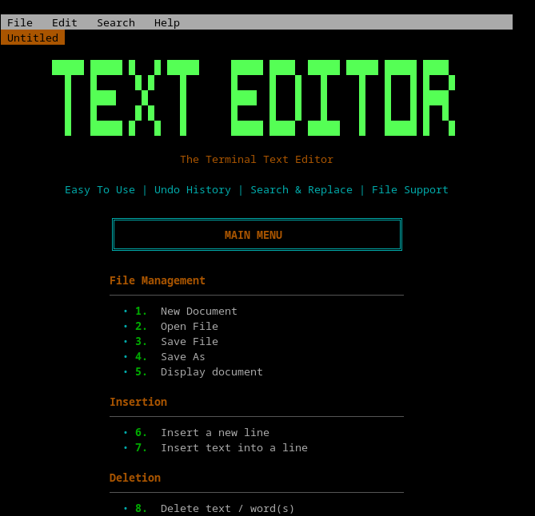
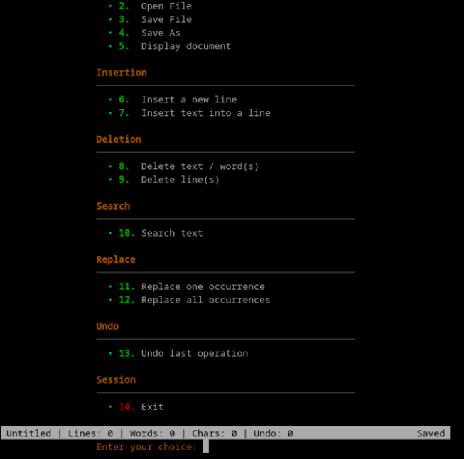

<div align="center">

# 📝 Terminal Text Editor

**A fast, menu-driven text editor for your terminal, built from scratch in C++.**


*Easy to Use · Undo History · Search & Replace · File Support*

</div>

---

## ✨ Overview

This project shows how core data structures and algorithms power the features of an everyday text editor. Instead of treating DSA as pure theory, we apply it to real editing operations: inserting, deleting, searching, replacing, and undoing changes, all inside a colorful terminal interface.

## 🖥️ Main Menu

<div align="center">





</div>

The status bar at the bottom shows the current file, line, word, and character counts, the undo history size, and whether the document is saved.

## 🚀 Features

- [x] **New, open, save, and save as** for `.txt` files
- [x] **Display** the document with line numbers
- [x] **Insert** new lines and insert text into any line
- [x] **Delete** text, words, and whole lines (single or ranges)
- [x] **Search** for text and list every match
- [x] **Replace** one occurrence or all occurrences
- [x] **Undo** the last operation, including multi-step edits
- [x] **Live status bar** with line, word, and character counts

## 🧠 Data Structures Used

| Feature | Data Structure / Algorithm |
|---|---|
| Document storage (lines, insert/delete) | Doubly linked list, one node per line |
| Search results | Dynamic array that grows automatically |
| Undo history | Stack (LIFO) |
| Text search | Linear scan with `std::string::find` |

## 📁 Folder Structure

```
Text-Editor/
├── include/                # Header files
│   ├── Document.h
│   ├── DynamicArray.h
│   ├── FileManager.h
│   ├── Replace.h
│   ├── Search.h
│   ├── Stack.h
│   ├── TextUtils.h
│   └── UndoManager.h
|   └── README.md
├── src/                    # Source files
│   ├── Document.cpp
│   ├── FileManager.cpp
│   ├── Replace.cpp
│   ├── Search.cpp
│   └── UndoManager.cpp
|   └── README.md
├── .gitignore
├── CMakeLists.txt          # Build configuration
├── LICENSE
├── main.cpp                # Entry point and menu
├── notes.txt               # Sample text file
└── README.md
```

## ⚙️ Getting Started

### Prerequisites

- A C++17 compiler (`g++`, `clang++`, or MSVC)
- [CMake](https://cmake.org/) 3.10 or newer
- Git

### Clone

```bash
git clone https://github.com/<your-username>/Text-Editor.git
cd Text-Editor
```

### Build and Run with CMake

```bash
mkdir build && cd build
cmake ..
cmake --build .
./text_editor
```

On Windows, run `.\Debug\text_editor.exe` or `.\text_editor.exe` instead.

### Quick Build without CMake

```bash
g++ -std=c++17 -Wall -Wextra -Iinclude main.cpp src/*.cpp -o text_editor
./text_editor
```

## 👥 Team

| Name | GitHub | Responsibilities |
|------|--------|------------------|
| Shifa Soomro | [@shifafareed79](https://github.com/shifafareed79) | Document (Linked List) |
| Muhammad Ibad Mirza | [@ibad-mirza](https://github.com/ibad-mirza) | Search & Replace (Dynamic Array) |
| Rameen Zulfi | [@r2meen](https://github.com/r2meen) | Undo System & Stack |
| Muhammad Saif Shoukat | [@Muhammad-Saif07](https://github.com/Muhammad-Saif07) | File Handling & Main Menu |

## 🎓 Course Information

Developed as part of **CS-218: Data Structures and Algorithms**.

## 📄 License

Distributed under the terms of the [LICENSE](LICENSE) file.

---

<div align="center">

**Made with ❤️ by Team Off Track**

</div>